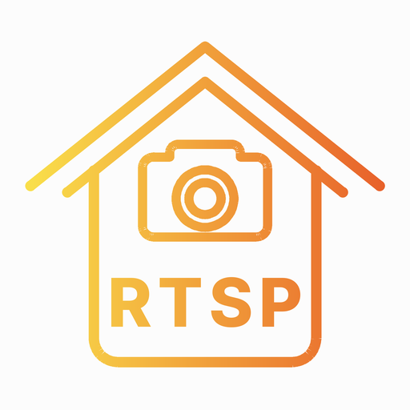
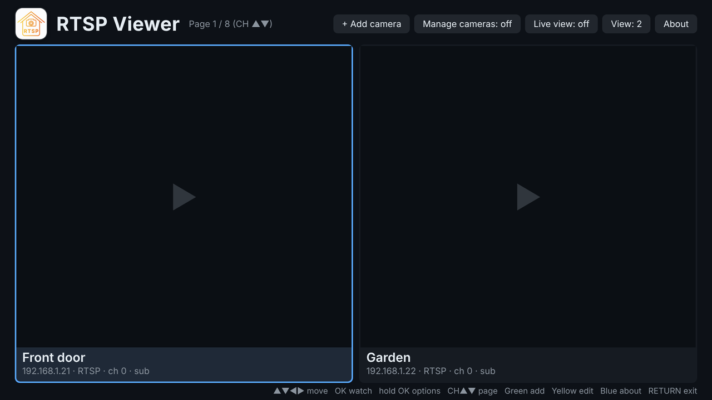
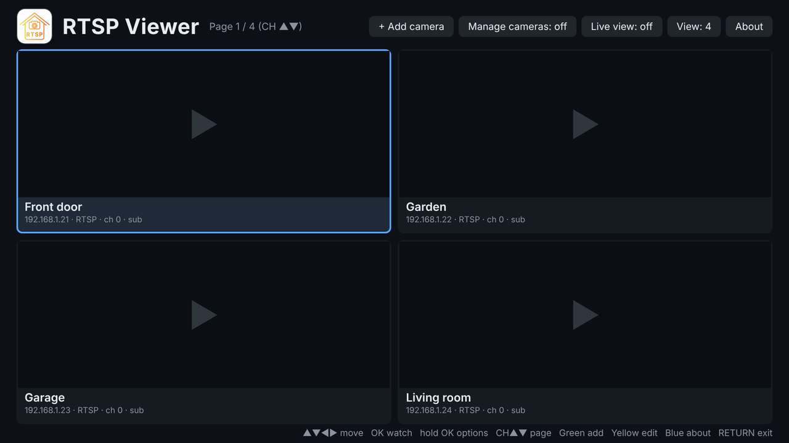
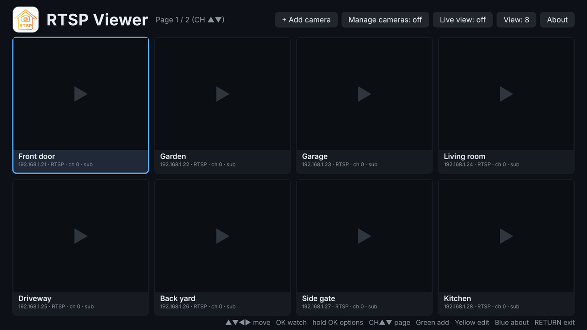
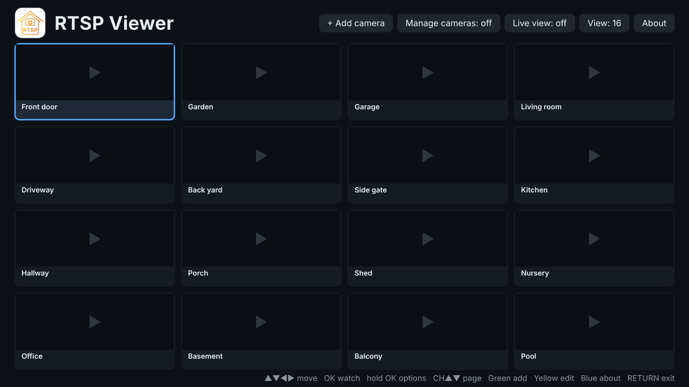
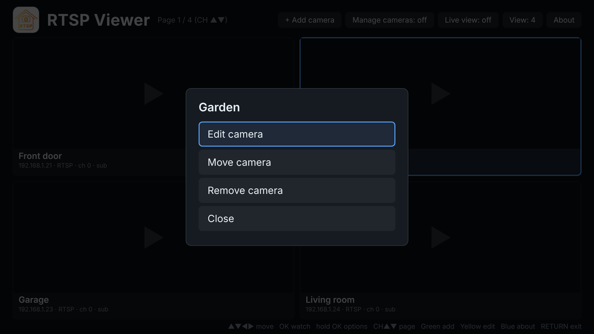
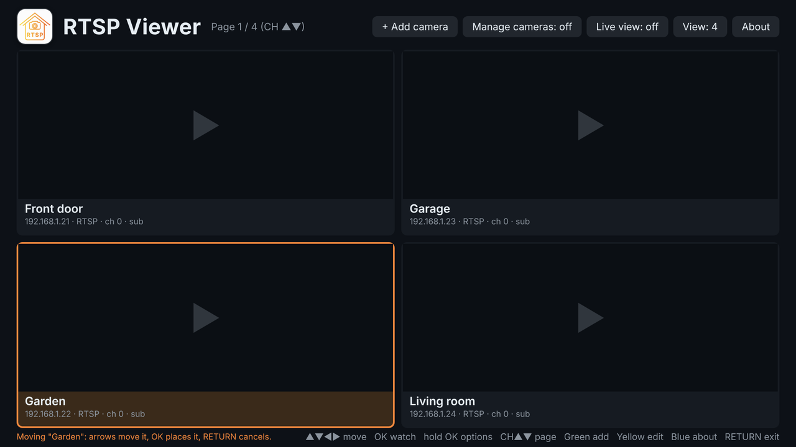
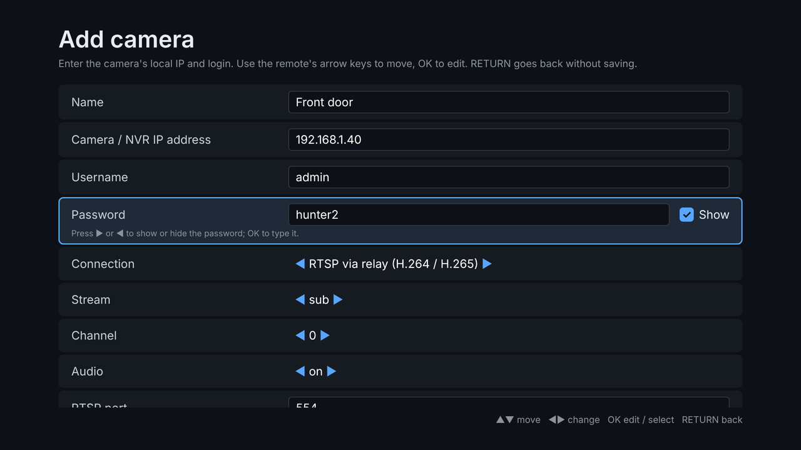
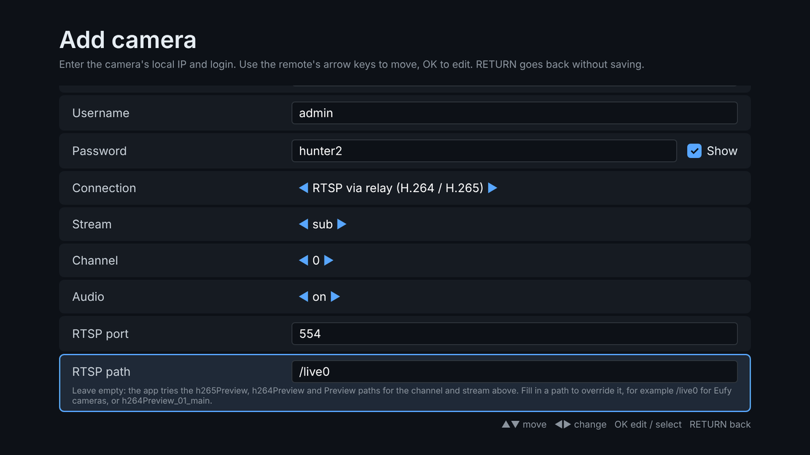
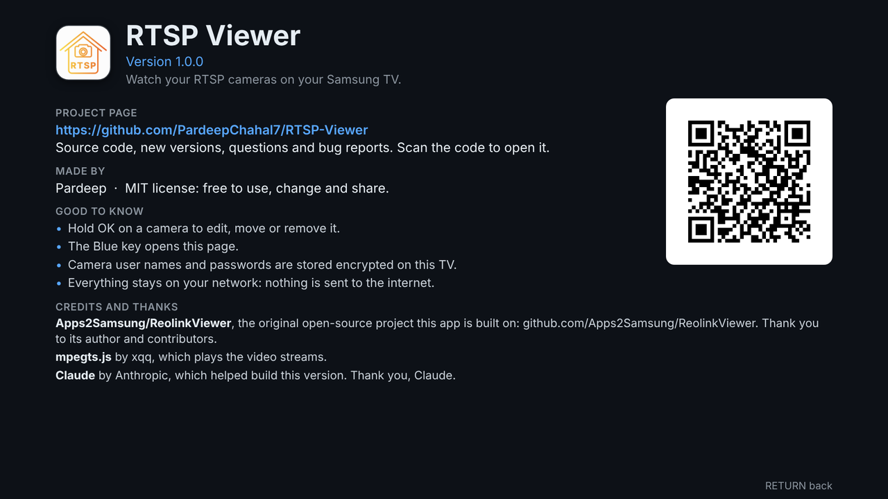

# RTSP Viewer

Watch your RTSP cameras (Eufy and others) and NVR channels on a Samsung TV.

- **Many cameras.** Save as many as you like and edit them at any time.
- **NVR-style main screen.** Choose **View: 2 / 4 / 8 / 16** to fit that many
  cameras on the screen, with pages when you have more.
- **Full screen.** Open any camera with OK and flip through them with CH ▲ / ▼.
- **Two ways in.** RTSP through a small relay service on the TV (H.264 and
  H.265), the default, or plain HTTP-FLV straight from the camera.
- **Options on every camera.** Hold OK on a tile to edit, move or remove it.
- **About screen.** Version, project page with a QR code, credits and a few
  tips; open it with the **About** button or the Blue key.
- **Encrypted logins.** Camera user names and passwords are encrypted before
  they are stored on the TV (see [Where your logins are kept](#where-your-logins-are-kept)).
- **Private.** Nothing leaves your network: no cloud account, no app server.
  The TV talks straight to the camera.
- **Optional live tiles.** Live video inside the tiles, off by default because
  many TVs can decode only one or two videos at once.

Made by Pardeep. Project page, downloads and issues:
**https://github.com/PardeepChahal7/RTSP-Viewer**

RTSP Viewer is built on
[Apps2Samsung/ReolinkViewer](https://github.com/Apps2Samsung/ReolinkViewer);
see [Credits and thanks](#credits-and-thanks).

## Screenshots

The camera screen has four sizes (**View: 2 / 4 / 8 / 16**); the tiles always
fill the whole screen, and more cameras than fit go onto further pages.

<table>
  <tr>
    <td><br><sub><b>View: 2</b></sub></td>
    <td><br><sub><b>View: 4</b> (the default)</sub></td>
  </tr>
  <tr>
    <td><br><sub><b>View: 8</b></sub></td>
    <td><br><sub><b>View: 16</b></sub></td>
  </tr>
</table>

Hold OK on a camera for its options, and move it through the list with the
arrow keys:

<table>
  <tr>
    <td><br><sub><b>Hold OK:</b> edit, move or remove</sub></td>
    <td><br><sub><b>Move camera:</b> arrows move it, OK places it</sub></td>
  </tr>
</table>

Adding a camera: RTSP is the default connection, the password can be shown with
the **Show** checkbox, and the RTSP path takes the path of your camera
(`/live0` for Eufy).

<table>
  <tr>
    <td><br><sub><b>Name, address and login</b></sub></td>
    <td><br><sub><b>RTSP port and path</b></sub></td>
  </tr>
</table>

The **About** screen (the About button, or the Blue key) shows the version, the
project page with a QR code, credits and a few tips:



These are the real app running in a desktop browser with made-up cameras, so the
tiles show a play symbol: live video in the tiles is optional (**Live view**,
off by default) and needs a TV that can play several streams at once. To retake
the pictures, see [Icon, QR code and screenshots](#icon-qr-code-and-screenshots).

## How it works

There are two ways to get the picture, chosen with the **Connection** field.
**RTSP** is the default. The `-legacy` package has no relay service, so there
new cameras start as HTTP-FLV.

**HTTP-FLV**. Some cameras and NVRs serve their live stream as
FLV over plain HTTP, the same endpoint their own web client uses. The app
fetches that stream and feeds it to the TV's own video decoder through Media
Source Extensions, using [mpegts.js](https://github.com/xqq/mpegts.js). No
transcoding, no helper box. It works on every Tizen TV, with one catch:
**the FLV endpoint only carries H.264.** Cameras whose main stream is H.265
(most 8 MP and 12 MP models at full resolution) will not show their main stream
this way. The **Sub** stream is H.264 on these cameras, so it is the
default and always works.

**RTSP** (2018 and newer TVs; the default). The full-quality H.265 main stream is available
over RTSP, which a TV web app cannot speak by itself. So the package carries a
small background service, [`service/relay.js`](service/relay.js), that runs on
the TV's Node.js runtime. It opens the camera's RTSP stream over TCP, unwraps
the H.265 (or H.264) and AAC, and re-wraps them as MPEG-TS on `127.0.0.1`,
still without transcoding; the TV's hardware decoder does the work. The app
plays that either in the browser (mpegts.js again, lowest delay) or, when the
browser cannot decode H.265, with Samsung's AVPlay from a live HLS playlist,
which runs a few seconds behind. **Player** = Automatic picks for you.

```
HTTP-FLV:  camera --FLV over HTTP--> web app (mpegts.js + MSE)
RTSP:      camera --RTSP/RTP over TCP--> relay service --MPEG-TS on 127.0.0.1--> web app (MSE) or AVPlay (HLS)
```

Not keen on RTSP? The zero-effort alternative for an H.265 camera is to set
its main stream to H.264 in the camera's app (Display/Stream → Main
Stream → Encoding) or to drop the resolution below 4K. On a TV the difference
is rarely visible.

## Will it work on my TV?

Any Samsung TV running Tizen 2.4 or newer (2016 models onward). The app is a
plain Tizen web app and needs no .NET runtime. There are two packages:

| Your TV | Download | What you get |
| --- | --- | --- |
| 2018 and newer (Tizen 4.0+) | `RTSPViewer.wgt` | HTTP-FLV and RTSP, including H.265 main streams through the relay. |
| 2016–2017 (Tizen 2.4 / 3.0) | `RTSPViewer-legacy.wgt` | HTTP-FLV only (H.264). The relay service needs Tizen 4.0. |

Build the packages with `bash build.sh` (see below).

## Installing

1. Download `RTSPViewer.wgt` (2018 and newer TVs) or `RTSPViewer-legacy.wgt`
   (2016-2017 TVs) from the
   [releases](https://github.com/PardeepChahal7/RTSP-Viewer/releases), and put
   the TV in Developer Mode (Apps → type `12345` on the remote); note its IP
   address.
2. Install the `.wgt` for your TV with
   [Apps2Samsung](https://github.com/Apps2Samsung/Apps2Samsung): it signs the
   package with a certificate for your TV and pushes it over the network. The
   packages in releases are unsigned, which no TV accepts as-is.
3. Launch **RTSP Viewer** from the TV's Apps list.

Building and installing by hand with Tizen Studio is covered below.

## Camera settings

On the camera or NVR, in its app or web client, under
**Network → Advanced → Port Settings**:

- For **HTTP-FLV**: make sure **HTTP** is enabled (port 80 by default). **Do not
  enable "HTTPS only"**: the TV's browser refuses the camera's self-signed
  certificate, so the stream must come over plain HTTP.
- For **RTSP**: make sure **RTSP** is enabled (port 554 by default). The relay
  uses TCP, so no port forwarding or firewall rules are needed on the TV side.
- Use a **dedicated user** if you like: a viewer-level user account is enough.
- For an **NVR**, enter the NVR's IP and login, and pick the camera with the
  **Channel** field (first camera is 0).

In RTSP mode, leave **RTSP path** empty and the app tries the standard stream
paths for the channel and stream you picked (`h265Preview_01_main`,
`h264Preview_01_main`, `Preview_01_main`, and the `_sub` / `_ext` variants).
If your device uses another path, type it into **RTSP path**.

For a **Eufy** camera, turn RTSP on for it in the Eufy app first, then enter the
camera's IP address, the RTSP user name and password you set there, RTSP port
`554` and RTSP path `/live0`.

The **Show** checkbox next to the password field shows what you typed: press ▶
or ◀ on the password row to tick it.

## Using the remote

The main screen is a grid of your saved cameras, like an NVR's channel view.
The **View** button in the toolbar picks how many cameras fit on the screen:
**2** (side by side), **4** (2 x 2), **8** (4 x 2) or **16** (4 x 4). The tiles
are sized to fill the whole screen, and the choice is remembered. With more
cameras than the view holds, the list is split into pages: move past the last
row, or press **CH ▲ / ▼**, to change page. Each tile shows the camera's name
and address; opening a camera plays it full screen.

Live tiles are small muted players on the light **Sub** stream (cameras with a
custom RTSP path, such as Eufy, use that path as is). FLV cameras are
read directly; RTSP cameras go through the relay, one slot per tile. Cameras
connect one after another, and leaving the camera screen closes every tile
stream, so the full-screen player has the camera to itself.

How many tiles are live is the **Live view** button in the toolbar: **off**
(default), **2**, **4** or **focus**. Only the tiles on the current page go live. Many TVs can play only one or two videos at
once. The app notices when a TV runs out: if it manages two or more, it keeps
those and says so ("This TV shows 2 live views at once"); if it manages only
one, it switches to **focus**, remembers that, and from then on the one live
tile follows the highlighted camera; the others show their name and
"Highlight to see live". Every camera still opens full screen. If the app ever
closes while live tiles are running, the next launch starts with Live view off
and says so; choose Live view to turn it back on. A running tile shows "● live 1920x1080 · 12 s" under it. A tile that
cannot go live says why ("wrong login", "unreachable", "H.265 not supported
here", "TV would not start playback", "no picture (state 0, 0x0, paused)" with
what the TV's video element reported, ...). H.265 cameras
cannot be shown in tiles on TVs whose browser has no H.265 decoder; switch the
camera to H.264 or open it full screen with the TV player.

Camera screen:

| Key | What it does |
| --- | --- |
| **▲ ▼ ◀ ▶** | Move between tiles; ▲ from the top row reaches the toolbar |
| **OK** | On a tile: watch it. On **+ Add camera**: add one. On **Manage cameras**: switch manage mode (OK on a tile then opens its options). On **Live view**: cycle off / 2 / 4 / focus. On **View**: cycle 2 / 4 / 8 / 16 |
| **Hold OK** (on a tile) | Options for that camera: **Edit camera**, **Move camera**, **Remove camera** |
| **CH ▲ / ▼** | Previous / next page of cameras |
| **Green** | Add a camera (colour keys: press the remote's colour/123 button) |
| **Yellow** | Edit the highlighted camera straight away |
| **Blue** | The About screen (also the **About** button in the toolbar) |
| **Back** | Exit the app |

The options of a camera:

- **Edit camera** opens the add / edit screen.
- **Move camera** picks the camera up: the arrow keys move it through the list
  (it follows onto other pages), **OK** puts it down, **Back** puts it back
  where it was.
- **Remove camera** asks first; the answer *No, keep it* is preselected.

Holding OK needs the TV to report when a key is released. If yours does not,
OK simply watches the camera; use **Manage cameras** (OK on a tile then opens
the options) or the **Yellow** key instead.

Add / edit camera screen:

| Key | What it does |
| --- | --- |
| **▲ / ▼** | Move between fields |
| **◀ / ▶** | Change a choice (connection, stream, channel, audio, player). On the password row: show or hide the password |
| **OK** | On a text field: open the on-screen keyboard. On a choice: next option. On **Save and watch** / **Save**: store the camera. On **Delete camera**: press twice to confirm |
| **Back** | Back to the camera screen without saving |

While watching:

| Key | What it does |
| --- | --- |
| **OK** | Show or hide the info overlay (camera name, codec, resolution, bandwidth, player, stream URL) |
| **CH ▲ / ▼** (or ▲ / ▼) | Next / previous saved camera (with a single camera saved: next / previous NVR channel) |
| **Play / Pause** | Pause; pressing again reconnects to the live edge |
| **Back** or **Stop** | Back to the camera screen |

Cameras are remembered on the TV. To watch several
channels of one NVR, add the NVR once per channel with a different **Channel**
number and name. Turn on **Connect automatically on launch** for a camera to
open it straight away when the app starts (Back then shows the camera screen).

If the stream drops, the app reconnects on its own with increasing delays. Press
Back to stop it trying. Leaving the player screen, or sending the app to the
background, closes the camera connection so your viewer slot is freed.

## Where your logins are kept

Camera user names and passwords are encrypted before they are written to the
TV's storage: AES-256-GCM through the browser's Web Crypto, with a new random
value for every save, and each login tied to its camera so it cannot be moved
to another one. The key is created on first start and kept in the app's
IndexedDB as a non-extractable key, so the app never has it as readable bytes.
Everything else about a camera (name, address, port and so on) is stored as
ordinary text.

What this does and does not do. It keeps the logins unreadable in copies of the
app's stored data, such as a backup or a dump of its data folder. It cannot
protect against code running inside the app itself or against someone who has
full control of the TV: a key that lives on the same device can never do more
than that. Use a viewer-level camera user, not the administrator.

- If the key is lost (for example the app's data was partly cleared), the saved
  logins cannot be read. The app says so, keeps the cameras, and you enter the
  user name and password again.
- A TV whose browser has no Web Crypto or IndexedDB stores logins as plain text.
  The app tells you at start-up when that is the case.
- Cameras saved in plain text by earlier test builds are encrypted the next
  time the app starts.

## Troubleshooting

| Message | Likely cause |
| --- | --- |
| *Cannot reach the camera* | Wrong IP, HTTP port disabled, "HTTPS only" enabled, or the TV is on a different network (guest Wi-Fi, VLAN). |
| *Cannot reach … over RTSP* | RTSP disabled on the camera, wrong RTSP port, or a different network. |
| *Login rejected* | Username or password wrong. User names are case-sensitive. |
| *This stream is H.265 and the TV's browser cannot decode it* | HTTP-FLV with an H.265 main stream. Switch Connection to RTSP, use Sub, or set the main stream to H.264. |
| *No stream at the known RTSP paths* | Wrong channel number, or a device with non-standard paths. Fill in **RTSP path**. |
| *The camera refused: too many viewers* / *The camera closed the stream* | Cameras limit concurrent viewers per stream. Close the camera's app on your phone and try again. |
| *RTSP mode needs the full package* | You installed `RTSPViewer-legacy.wgt`, which has no relay. Install `RTSPViewer.wgt` (2018+ TVs). |
| *The relay service did not start* | The TV refused to launch the background service. Reinstall the package; if it persists, open an issue with your model. |
| *The browser player cannot decode this stream* | Set **Player** to TV player (AVPlay). Automatic does this by itself after the first failure. |
| *This TV does not support Media Source Extensions* | A very old or unusual firmware. In RTSP mode, set Player to TV player. |

## Build and install by hand

```bash
git clone https://github.com/PardeepChahal7/RTSP-Viewer.git
cd RTSP-Viewer
bash build.sh                          # dist/RTSPViewer.wgt and dist/RTSPViewer-legacy.wgt, unsigned
TIZEN_PROFILE=MyTv bash build.sh --sign            # signed with a Tizen Studio certificate profile
TIZEN_PROFILE=MyTv bash build.sh --install 192.168.1.20   # ...and installed and launched on that TV
```

Signing needs [Tizen Studio](https://developer.samsung.com/smarttv/develop/getting-started/setting-up-sdk/installing-tv-sdk.html)
with the TV extension, a Samsung certificate profile for your TV (made with the
Certificate Manager), and `tizen` and `sdb` on your `PATH`
(`<tizen-studio>/tools/ide/bin` and `<tizen-studio>/tools`). Unsigned
packages need only `zip` or Python 3.

Both packages come from one source tree: the legacy one is the same app with
the block between the `rtsp-mode` markers in `config.xml` removed and
`required_version` set back to 2.4.

### Icon, QR code and screenshots

`tools/make_icon.py` draws `icon.png` and `tools/make_qr.py` draws
`qr-repo.png` (the code on the About screen); both need Python 3 with Pillow,
the QR one also reportlab. Change `URL` in `make_qr.py` and run it again if the
project page ever moves.

`tools/make_screenshots.py` retakes everything in `docs/screenshots/` from the
real app in headless Chromium, with made-up cameras (`pip install playwright
pillow`, then `playwright install chromium`).

### Tests

```bash
node --test tests/relay.test.js   # RTSP parsers, depacketizers, TS muxer, several fake cameras end to end
node tests/ui/run.js              # the screens: camera list, views and paging, options menu, form, encrypted storage, live tiles, crash guard
tests/e2e.sh                      # real encoders and decoders: needs ffmpeg, ffprobe and mediamtx
```

The screen tests run the real `js/app.js` against a small fake DOM, fake relay
and fake player (`tests/ui/harness.js`), so they need nothing but Node.js. They
cannot prove how a particular TV behaves: tile video in particular depends on
how many video decoders the TV has.

## Credits and thanks

RTSP Viewer is made by **Pardeep**
([PardeepChahal7/RTSP-Viewer](https://github.com/PardeepChahal7/RTSP-Viewer)),
and it stands on the work of others. Thanks go to all of them:

- **[Apps2Samsung/ReolinkViewer](https://github.com/Apps2Samsung/ReolinkViewer)**,
  the original open-source project. Its Tizen web app, HTTP-FLV player, RTSP
  relay service and packaging scripts are the foundation of this app. Thank you
  to its author and contributors for building it and for releasing it under the
  MIT license.
- **[Apps2Samsung](https://github.com/Apps2Samsung/Apps2Samsung)**, the tool
  that signs apps for your TV and installs them.
- **[mpegts.js](https://github.com/xqq/mpegts.js)** by xqq, which feeds the
  streams to the TV's video decoder. See
  [`THIRD_PARTY_NOTICES.md`](THIRD_PARTY_NOTICES.md).
- **[Claude](https://www.anthropic.com/claude)**, the AI assistant from
  Anthropic, which helped build this version: multi-camera support, the
  NVR-style screens and View modes, live tiles, the app icon, the tests and
  this documentation. Thank you, Claude.

## Contributing

Bug reports, TV models that work (or do not), and pull requests are welcome at
[github.com/PardeepChahal7/RTSP-Viewer/issues](https://github.com/PardeepChahal7/RTSP-Viewer/issues).
Please run both test suites (see [Tests](#tests)) before opening a pull request.

## License

[MIT](LICENSE). Copyright (c) 2026 Pardeep. The original copyright notice is kept,
as the license requires, and the new work is released under the same terms.
